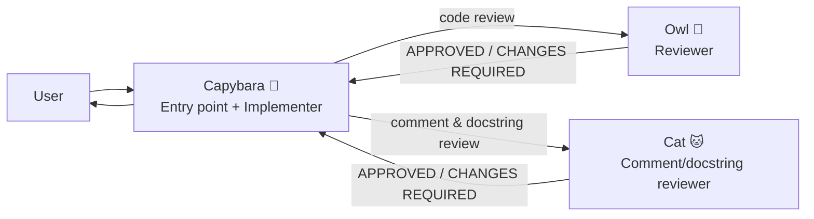
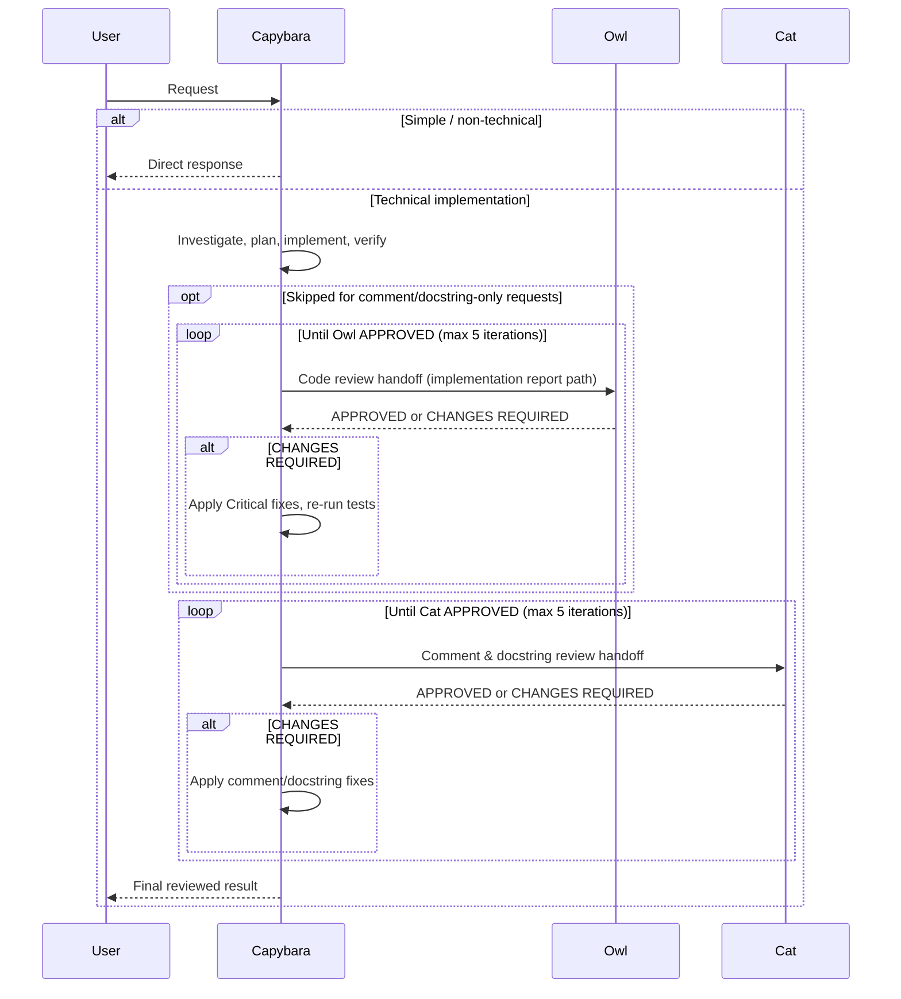

# GitHub Copilot Squad (Simplified)

A simplified orchestration setup for the **VS Code Agents window** (built on the Copilot SDK harness), and a leaner variant of [github-copilot-squad](https://github.com/kevinkwee/github-copilot-squad). It ships in two modes:

- **Trio (default)**: `Capybara` (entry point + implementer) + `Owl` (code reviewer) + `Cat` (comment/docstring reviewer).
- **Duo**: `Capybara` + `Owl` only, with no dedicated comment/docstring pass. The Duo behavior lives in `CapybaraDuo.agent.md`.

In both modes the goal is the same: keep implementation and review as **separate perspectives**, so technical work goes through a build → review loop before final output. What's removed (vs the original 4-agent squad) is the overhead of a separate execution agent and a separate lightweight helper.

## Why this simplified version exists

The original squad offloads implementation to a dedicated builder agent (`Otter`), with `Capybara` acting as a pure router. After using it on real-world tasks, that separation turned out to be **unnecessary** for this setup, for a few reasons:

- **A separate generalist implementer adds little value.** Spinning up a separate agent just to offload execution only pays off when that agent is **specialized**: a frontend specialist, a backend specialist, or a specific-framework specialist that brings domain knowledge the orchestrator lacks. Our implementer (`Otter`) was a **generalist**, just like `Capybara`. Two generalists don't give you more perspective; they give you more handoff overhead.
- **A fresh isolated context per request is expensive.** Because `Otter` is a separate subagent, every user request starts in a **fresh, isolated context**. That means more tokens and more time for the agent to re-read the codebase, re-analyze the problem, and rebuild understanding, even for a follow-up that builds directly on what was just done.
- **Merging keeps the working context warm.** When `Capybara` does the implementation itself, it **retains context about what was just built**. A subsequent request doesn't need the agent to reanalyze the same files and decisions over and over; the relevant context is already there.

### The trade-off

Merging the implementer into the entry point is not free:

| Approach | Pro | Con |
| --- | --- | --- |
| **Separate implementer** (`Otter`) | Each request gets a clean, isolated context, so the orchestrator's context window stays small. | Fresh context every time → more tokens and time to re-analyze. Temp reports capture what was done, but not the implementer's chain-of-thought or detailed analysis (what it read and reasoned through), so follow-ups can't reuse that thinking. |
| **Merged into `Capybara`** (this repo) | Full working context (including the chain-of-thought) carries over to follow-ups; no redundant re-analysis; fewer agent handoffs. | The context window grows as the conversation gets longer. |

The original concern with merging was that **the context window would fill up quickly**. In practice (after running it on real, multi-step tasks), that growth turned out to be **slower than expected**, and the benefit of warm, carry-over context outweighed the cost. Hence this simplified version.

> **When to use the original squad instead:** if you start wiring in **specialized** implementers (e.g. a frontend-focused agent that knows a specific UI framework, or a backend agent tuned to a particular stack), the separate-agent model becomes worth it again. This simplified repo assumes a single generalist does the building.

## Why a dedicated comment/docstring reviewer (Trio)

Agents sometimes write unnecessary, redundant, or inappropriate comments and docstrings, even when the rules are already stated in `AGENTS.md`. Owl's review covers this, but Owl also reviews the code implementation, so these prose issues sometimes get skipped in practice.

The Trio mode adds **Cat**, a reviewer that focuses **only** on comments and docstrings. It runs after Owl approves the implementation (or directly for comment/docstring-only requests), so the code is already correct; Cat's whole job is to groom the prose. The expected comment/docstring rules live in `AGENTS.md`, so they stay easy to update and maintain.

Because Cat owns the prose review, Trio also lets Capybara skip Owl and call Cat directly for **comment/docstring-only requests** (changes that touch only comments and/or docstrings), avoiding a redundant code-logic review pass when there is no logic change to review.

## The team (two modes)

**Trio (default)** adds a focused comment/docstring pass after Owl approves:



**Duo** is the lighter variant: the same flow without the Cat stage (Capybara → Owl → finish).

- **Capybara** is the only user-invocable agent. It receives the request, investigates, plans, implements, runs tests, and writes an implementation summary, then runs the review loop(s).
- **Owl** is not user-invocable. It reviews Capybara's implementation independently (correctness, completeness, quality, tests), classifies findings as Critical or Minor, and returns `APPROVED` or `CHANGES REQUIRED`.
- **Cat** (Trio only) is not user-invocable. After Owl approves, it reviews **only** the comments and docstrings, classifies findings as Critical or Minor, and returns `APPROVED` or `CHANGES REQUIRED`.
- Capybara applies all **Critical** findings from Owl (and Cat, in Trio), re-reviews if needed, and returns the final result to the user.

**Agent files in this repo:** in [`agents/`](agents/): `Capybara.agent.md` (Trio, default), `CapybaraDuo.agent.md` (Duo variant), `Owl.agent.md`, `Cat.agent.md`.

**Hook files in this repo:** in [`hooks/`](hooks/) and [`scripts/guard-pwsh-continuation/`](scripts/guard-pwsh-continuation/): the `guard-pwsh-continuation` PreToolUse config plus its companion script and test battery (see the Hooks section).

**Installer files in this repo:** [`install.ps1`](install.ps1) installs or uninstalls the agents, skills, and hooks at user level or repo level, and [`test-install.ps1`](test-install.ps1) is its test battery (see the Scripted install section).

## Harness-agnostic design

The squad avoids naming tools so it does not break when the underlying Copilot SDK renames or reshapes them:

- Agent frontmatter pins no `tools:` list, so every agent inherits the harness default tool set.
- Instructions reference capabilities only: ask the user, create a todo list, run tests in a terminal, delegate to a reviewer as a subagent and wait for its verdict.
- Constraints such as "you MUST NOT call yourself as a subagent" live in the instructions, so they hold on every harness.

If a harness lacks a capability the squad depends on, such as asking the user, running commands, or delegating subagents, the agents surface that instead of silently degrading.

## Quick start

### Prerequisites

- VS Code with Copilot custom agents support (Agents window or Chat view)

### Scripted install (install.ps1)

From a clone of this repo, run without arguments to get the interactive menu:

```powershell
pwsh -NoProfile -ExecutionPolicy Bypass -File install.ps1
```

The menu asks whether to install or uninstall, which components to include (one or more of `agents`, `skills`, and `hooks`, for example by entering `2,3`, or `all` for everything), and whether to install at the user level (`~/.copilot/`) or the repo level (a project's `.github/` folder). It shows the plan and a confirmation before touching anything. Installs overwrite conflicting files by name; uninstalls remove only the squad's own files and list anything else matching a squad name (such as `.disabled` renames) for manual review.

For scripted use, flags replace the menu:

```powershell
pwsh -NoProfile -ExecutionPolicy Bypass -File install.ps1 -Action install -Components all -Level user -OwlModel 'GLM-5.3' -OwlReasoningEffort high -CatModel 'flash' -CatReasoningEffort low
```

- `-Components` picks the parts: one or more of `agents`, `skills`, and `hooks` (comma separated, for example `-Components agents,skills`), or `all` for everything, which cannot be combined with named components. Each hook's JSON and its companion script install together, and each JSON's placeholder script path is rewritten for the chosen level, so no manual path edit remains. An agents install carries the subagent delegation hook too, per `-SubagentGuard` below. The agents component rewrites the per-subagent model and effort placeholders inside the installed `Capybara` and `Capybara Duo` files the same way.
- `-OwlModel <id or name part>`, `-OwlReasoningEffort <effort>`, `-CatModel <id or name part>`, and `-CatReasoningEffort <effort>` supply the per-subagent values the installer writes into those placeholders. Scripted installs that include the `agents` component on the install action require all four, and they fail fast for any other run. Interactive runs are asked for the same four values (see the Subagent model note).
- `-SubagentGuard Auto|Skip|Force` (default `Auto`) controls the subagent delegation guard hook, which denies a reviewer subagent call that omits `model` or `reasoning_effort` (see the Hooks section). `Auto` installs it whenever the agents component is installed, `Skip` leaves it out and fails fast on any install that does not include the agents component, and `Force` installs it into any install that includes the agents or hooks component, for example a hooks-only install for a hand-maintained agents folder (runs selecting neither fail fast). Only install runs accept a non-`Auto` value.
- `-Level user` (default) writes under `%USERPROFILE%\.copilot\`. `-Level repo` writes under the project's `.github\` folder and requires `-ProjectRoot <path>`.
- `-UserRoot <path>` overrides the user-level target root for one run, mainly for previews into a scratch folder; repo-level runs do not accept it.
- `-Action uninstall` uses the same component and level choices to remove the squad's files. Add `-WhatIf` to either action for a dry run that only prints the plan.

The installer's test battery verifies the whole script against disposable temp folders; run it from the repo root with `pwsh -NoProfile -File test-install.ps1`.

### Option A: Repo-level agents (recommended)

Copy the agent profiles into:

- `.github/agents/*.agent.md`

This makes them available for that repository/workspace. In this repo the profiles live in [`agents/`](agents/), so copying (or linking) that folder's files into your project's `.github/agents/` is enough once you replace the Owl and Cat placeholders in the two Capybara files (see the Subagent model note); the `skills/` folder ships `agents-md`, `commit-message`, `gh-multi-account`, and `pr-description` the same way; and the `hooks/` and `scripts/` folders ship the two squad hooks (`guard-pwsh-continuation` and `guard-subagent-delegation`), whose install steps (including the required script-path edits in the JSONs) are in the Hooks section.

The scripted install performs the same copies and fills the placeholders by itself: run it with `-Level repo -ProjectRoot <the project>` (see the Scripted install section).

### Option B: User-level agents

Create user-level custom agents with the **Agent Customizations editor** (or the **Chat: New Custom Agent** command), or place the `.agent.md` files in `~/.copilot/agents/`, the folder agent host sessions read user-level agents from. From a squad clone, run `install.ps1` without flags and choose user level at the menu, or run the scripted form from the Scripted install section with `-Level user`. Both fill the same folders.

Files placed by hand must have their placeholders replaced too, same as Option A.

This makes them available across your workspaces.

### Subagent model note

The agents do not pin `model:` frontmatter. The Agents window ignores a `target:` pin and mishandles a pinned `model:` that comes from an extension (a connector model), so the squad does not rely on frontmatter for this. Instead, Capybara's delegation rule sets what Owl and Cat run on. When the calling tool supports choosing both the model and the reasoning effort, Capybara runs them on the configured values, unless the user names a model for the call at run time. Otherwise they run on the tool's defaults.

Each reviewer has its own pair, shipped as placeholders: Owl gets `__OWL_MODEL__` and `__OWL_REASONING_EFFORT__`, Cat gets `__CAT_MODEL__` and `__CAT_REASONING_EFFORT__`, and the installer fills all four. The `Capybara Duo` file carries only the Owl pair. The model values may be the full id or a distinctive part of the name, for example `GLM-5.3`. They do not have to match exactly. At run time Capybara runs each reviewer on the first available model that matches its value, and asks how to proceed when nothing available matches.

The interactive menu asks for the four values, and scripted installs that include the `agents` component take `-OwlModel`, `-OwlReasoningEffort`, `-CatModel`, and `-CatReasoningEffort` instead. If you copy files manually without the installer, replace the placeholders yourself right after copying. An installed file with a placeholder left in place leaves the reviewers on an unfilled model name, so their calls do not resolve until you fix it.

Reasoning effort values differ per harness. `low`, `medium`, and `high` are the common choices.

Enforcement of the note is also installable. With the default `-SubagentGuard Auto`, the installer also deploys the subagent delegation guard hook, and a subagent call that starts Owl or Cat without both `model` and `reasoning_effort` is then denied by the hook with a reason telling the caller to retry with both fields set, or to surface the limitation when its tool cannot set them. Presence is enforced, not the value, so a reviewer run on a model the user names at run time instead of the configured one still passes, and calls that name other agents are untouched. A harness without hook support simply falls back to the tool's defaults, exactly as the delegation rule says. `Skip` opts out of an agents install and `Force` deploys the hook into a hooks-only install (see the Hooks section).

### Use it

1. Open the Agents window (or the Chat view) in VS Code.
2. Select `Capybara` (Trio, default) or `Capybara Duo` from the agent picker.
3. Ask your request naturally.
4. For technical requests, `Capybara` implements, then runs the Owl review loop (and, in Trio, the Cat comment/docstring loop).

## How the flow works

### 1) Entry point

`Capybara` receives every request directly. There is no router and no lightweight helper; it handles both technical and simple/non-technical requests itself:

- **Regular technical request** → investigate, plan, implement, verify, then enter the code review loop with Owl (and, in Trio, the Cat loop after).
- **Comment/docstring-only request** (Trio) → investigate, plan, implement, verify, then skip Owl and go straight to the Cat loop, since Owl reviews code logic and there is no logic change to review.
- **Simple / non-technical request** → answer directly (no review needed).
- **Ambiguous request** → asks a clarification question first.

### 2) Code review loop (Capybara ↔ Owl)

For technical requests, `Capybara` runs this loop. **In Trio, this loop is skipped for comment/docstring-only requests** (Capybara goes straight to the Cat loop in section 3, since there is no code logic to review):

1. Create report folder path: `.github/temp_reports/{YYYYMMDD_HHmmss}_{objective}/`
2. Implement the task and write `implementation_1.md` into that folder.
3. Hand off to `Owl` (focused handoff: the implementation report path, not the whole conversation).
4. If `Owl` returns **APPROVED** → in Trio, proceed to section 3 (the Cat loop); in Duo, return the final result.
5. If `Owl` returns **CHANGES REQUIRED** → apply every Critical fix, re-run tests, write a fresh `implementation_{iteration}.md` (next number), and call `Owl` again (Owl writes `review_{iteration}.md` with that same number).
6. Repeat until approved, max 5 iterations.

If still not approved after 5 iterations, `Capybara` stops and surfaces the remaining Critical issues for the user to decide (the Cat loop is skipped).

### 3) Comment & docstring review loop (Capybara ↔ Cat, Trio only)

Trio mode runs a second, focused loop with `Cat`. For regular technical requests it runs after Owl approves. For comment/docstring-only requests it runs right after implementation (Owl was skipped). Cat's review number always equals the `implementation_*.md` number it reviews, so when Owl approves `implementation_N.md`, Cat writes `docstring_review_N.md` (no increment between Owl and Cat):

1. Hand off to `Cat` (focused handoff: the report subfolder, the number N of the latest `implementation_*.md`, and every `implementation_*.md` Cat has not reviewed yet). At the Owl-to-Cat transition Cat is handed `implementation_1.md`..`implementation_N.md` (all of them, since this is its first review) but writes a single `docstring_review_{N}.md`. "Handed" scopes the handoff, not Cat's tool access. Cat can read more from disk if it needs extra context.
2. If `Cat` returns **APPROVED** → return the final result.
3. If `Cat` returns **CHANGES REQUIRED** → apply every Critical fix (and any cheap minor suggestions), re-run tests/lint if code is touched, write a fresh `implementation_{iteration}.md` (next number), and call `Cat` again (Cat writes `docstring_review_{iteration}.md` with that same number).
4. Repeat until approved, max 5 iterations.

If still not approved after 5 iterations, `Capybara` stops and surfaces the remaining Critical issues for the user to decide.

### Flow diagram (Trio)



> Duo mode is the same flow without the Cat loop: after Owl approves, Capybara returns the final result.

## Agent responsibilities

### Capybara (`Capybara.agent.md`, Trio default)

- Single entry point: receives requests and acts on them directly.
- Does the technical work: investigate, plan, implement, run tests, lint/format.
- Manages the Capybara ↔ Owl code review loop, then the Capybara ↔ Cat comment/docstring loop (each max 5 iterations).
- For comment/docstring-only requests (Trio), skips the Owl loop and goes straight to the Cat loop.
- Applies **all** Critical findings from Owl and Cat; never skips them by reasoning them away.
- Asks clarifying questions (with freeform input) when the request is ambiguous.
- User-invocable; `disable-model-invocation: true` (so it always runs as the explicit entry point).

### Capybara Duo (`CapybaraDuo.agent.md`)

- The Duo variant of Capybara: same entry point + implementer role, but with only the Capybara ↔ Owl loop (no Cat pass).
- Use this when you don't want a dedicated comment/docstring review pass.

### Owl (`Owl.agent.md`)

- Reviews the code implementation for correctness, completeness, and quality.
- Reads the `implementation_{iteration}.md` summary **and** the actual changed files from disk.
- Runs available tests for touched modules to detect regressions.
- Classifies findings:
  - **Critical** → blocks approval (`CHANGES REQUIRED`)
  - **Minor** → suggestions only
- Writes `review_{iteration}.md` to the report subfolder.
- Not user-invocable; called only by Capybara.

### Cat (`Cat.agent.md`, Trio only)

- Reviews **only** the comments and docstrings in the changed files (after Owl approves the implementation).
- Does NOT review code logic, correctness, architecture, or tests; Owl owns that.
- Applies its own general principles (cold-reader oriented; comments explain WHY, never WHAT) and follows the detailed comment/docstring rules in `AGENTS.md`.
- Reads all `implementation_*.md` reports Capybara hands it (at the Owl-to-Cat transition, all of `implementation_1.md`..`implementation_N.md`; on later re-reviews, only the new `implementation_*.md` since its last `docstring_review_*.md`) and writes a single `docstring_review_{iteration}.md` per call. The handed reports scope the review, not what Cat may read. Cat can read more from disk if it needs extra context.
- Classifies findings:
  - **Critical** → blocks approval (`CHANGES REQUIRED`)
  - **Minor** → suggestions only
- Writes `docstring_review_{iteration}.md` to the report subfolder.
- Not user-invocable; called only by Capybara.

## Project code-writing rules (`AGENTS.md`)

`Capybara`, `Owl`, and `Cat` all treat an attached `AGENTS.md` as the source of truth for the project's stack, idioms, and quality bar (test commands, lint/format, naming, architecture rules, and the expected comment/docstring rules). The detailed code-writing rules have been **stripped out** of the agent profiles and moved into a per-project `AGENTS.md` that you provide alongside the agents.

A separate `AGENTS.md` is **easier to update and maintain**, especially when it contains a section that is **managed by the agent itself** (the agent can read and edit `AGENTS.md` in place without you having to edit the bundled agent profile).

**Blank projects**: when a project has no `AGENTS.md` at all, `Capybara` bootstraps one on the first implementation request. Until the file exists, the `agents-md` skill's bundled template rules are the baseline. The plan makes bootstrapping its first item, so approving the plan approves it, and declining it in the plan feedback skips it. The plan's execution starts there: the `agents-md` skill runs in create mode (see the [AGENTS.md skill](#agentsmd-skill)) and derives the file's content from the task's requirements instead of a separate interview. The new `AGENTS.md` then applies like a provided one, so the file is created at most once per project. A declined bootstrap becomes the plan's first item again on the next implementation request. Comment/docstring-only, commit, and PR requests never trigger it.

> The template ships inside the `agents-md` skill below: fill the placeholder comments, delete the sections your project does not need, and adapt the language-specific examples to your stack. The skill automates this for you, both when creating a new file and when aligning an existing one.

## AGENTS.md skill

The repo ships a skill that applies the template to your project. The template lives inside the skill at [`skills/agents-md/assets/AGENTS-template.md`](skills/agents-md/assets/AGENTS-template.md):

```text
skills/
└── agents-md/
    ├── SKILL.md              # the procedure (create + adapt modes)
    └── assets/
        └── AGENTS-template.md # the canonical template
```

- **`/agents-md create`**: inspects the repo (stack, versions, commands, layout, test and coverage tooling), asks only for facts the code cannot answer, then fills the template's placeholders and drops the sections your project does not need. Produces a ready, project-specific `AGENTS.md` (default: repo root).
- **`/agents-md adapt <path>`**: audits an existing `AGENTS.md` against the template, then proposes add/modify/keep changes. Deliberate project-specific choices are preserved and flagged, never silently overwritten. The skill's writing conventions (no em/en dashes, no hyphen-as-clause-separator) always converge.
- **Automatic bootstrap**: `Capybara` invokes this skill itself when implementing in a project that has no `AGENTS.md` yet, deriving the content from the task's requirements (see [Project code-writing rules](#project-code-writing-rules-agentsmd)).
- **Deployment**: `skills/` sits at the repo root on purpose. Clone this whole repo into your project's `.github/` folder (or copy just the `skills/` folder into it) and the skill lands at `.github/skills/agents-md/`, where VS Code discovers it.
- **Template edits**: edit `skills/agents-md/assets/AGENTS-template.md` directly; it is the single canonical template inside this repo, and the skill always reads it from there.

## Commit message skill

A second shipped skill writes commit messages:

```text
skills/
└── commit-message/
    └── SKILL.md              # Conventional Commits procedure
```

- **`/commit-message`**: reads the staged changes (`git diff --cached`), matches the repo's recent message style, and writes a Conventional Commits message (type, optional scope, imperative single-line description, optional body and footer, `!` before the colon for breaking changes). It never stages files itself, and never mentions unstaged changes.
- **Style authority**: load it before any commit, including one a built-in commit workflow skill performs. It owns the message rules.
- **After presenting the message** it asks how to proceed: commit as-is, revise, or leave it as message only. Commit as-is runs through the session's built-in commit skill when one exists; otherwise it commits directly with PowerShell-safe quoting rules (single-quote strategy, or the backtick escape when double quotes are needed), one `-m` per paragraph.
- **Deployment**: same model as `agents-md`; the skill is discovered at `.github/skills/commit-message/` when this repo is cloned or the `skills/` folder copied into your project's `.github/`.

## PR description skill

A third shipped skill writes PR titles and descriptions:

```text
skills/
└── pr-description/
    └── SKILL.md              # PR title + description procedure
```

- **`/pr-description`**: derives the base branch and merge base, reads every commit message on the branch plus the diff, then writes a Conventional Commits style title (single line, imperative, `!` before the colon when breaking) and a full description. Uses repo-level PR templates when found (`.github/PULL_REQUEST_TEMPLATE.md`), falls back to a built-in default format (Summary, Type of Change, Key Changes, Notes, How This Has Been Tested).
- **Template handling**: a user-supplied template wins, and the result is returned in a code block rather than written into any template file (unless you explicitly ask for that).
- **Style authority**: load it before any PR creation or update, including by a built-in PR workflow skill. It owns the title and description style.
- **After presenting** the title and description it asks how to proceed: create the PR as-is (through the session's built-in PR creation skills when present, otherwise `gh pr create`, confirming the target branch first), create it as a draft when the user has not specified, or text only. Freeform input revises it.
- **Deployment**: same model as the other skills; discovered at `.github/skills/pr-description/`.

## Multi-account gh skill

A fourth shipped skill runs gh and gh-authenticated git commands as a specific logged-in GitHub account:

```text
skills/
└── gh-multi-account/
    └── SKILL.md              # scoped GH_TOKEN export procedure
```

- **`/gh-multi-account`**: exports the target account's token (`gh auth token --user <account>`) into `GH_TOKEN` for a group of commands and clears it afterward, so gh calls and https git authentication act as that account without touching the active account.
- **No account switching**: `gh auth switch` permanently changes the active account, so the skill replaces it with the scoped export and cleanup pattern.
- **Verified behavior notes** (gh 2.86.0): the `--user` lookup reads the stored credential even while `GH_TOKEN` is already set, ssh remotes bypass the gh credential helper, and `gh auth status` marks the export active and the keyring accounts inactive while it is set.
- **Deployment**: same model as the other skills; discovered at `.github/skills/gh-multi-account/`.

## Hooks

The repo ships hooks the same way as agents and skills, with configs and scripts separated so the `hooks/` folder stays a flat list of JSON files as the collection grows:

- **`hooks/`** holds the JSON hook configs. The Copilot SDK harness combines all hook sources and runs every entry it finds: user-level `*.json` files in `%USERPROFILE%\.copilot\hooks\` (or `~/.copilot/hooks/`), and repo-level `*.json` files in a project's `.github/hooks/`.
- **`scripts/`** holds the companion scripts, one subfolder per hook, at the same install depth: `%USERPROFILE%\.copilot\scripts\` for user-level installs, `.github/scripts/` for repo-level installs.

```text
hooks/
├── guard-pwsh-continuation.json            # PreToolUse hook config (user-level form)
└── guard-subagent-delegation.json          # PreToolUse hook config (user-level form)

scripts/
├── guard-pwsh-continuation/
│   ├── guard-pwsh-continuation.ps1         # the shell guard
│   └── test-guard-pwsh-continuation.ps1    # out-of-process test battery
└── guard-subagent-delegation/
    ├── guard-subagent-delegation.ps1       # the delegation guard
    └── test-guard-subagent-delegation.ps1  # out-of-process test battery
```

### User-level install (recommended)

One install covers every Copilot SDK session in every workspace: VS Code Agents window and Chat view Copilot sessions on the Agent Host, and Copilot CLI, which share the same SDK hook implementation.

1. Copy each `scripts/<hook-name>/` folder into `%USERPROFILE%\.copilot\scripts\`.
2. Copy each `hooks/<hook-name>.json` into `%USERPROFILE%\.copilot\hooks\`.
3. Edit the copied JSONs so the `pwsh -File` argument is the absolute path to the script: replace the `C:/Users/YOUR-PROFILE` segment with your Windows profile folder (for example, the folder shown by `%USERPROFILE%`).

The install script with `-Components hooks` performs these three steps for both hooks (including the placeholder edits) automatically. A hooks-only install carries only the shell guard unless `-SubagentGuard Force` is passed, and an agents install carries the delegation guard by default.

Step 3 is required before the guards work, and the hooks fail closed until that edit is applied: the shipped `-File` path is a placeholder, `pwsh` cannot launch a missing script file and exits non-zero, and the Copilot SDK harness treats a non-zero hook exit as a deny for every matched tool call.

The absolute path is required because the harness derives the hook command's working directory from the session, not from the JSON file's location: the repository root when the session's working directory sits inside a git repository, the session's working directory otherwise, and the system temp dir when neither is usable. A repo-relative `-File` path would resolve against whichever project each session runs over, and deny shell commands in every project that has not deployed the script at that path.

To verify the guard functionally, ask an agent in a Copilot session to run an incomplete PowerShell command (for example a `Write-Host` with an unclosed quote). The guard denies the call with a rewrite hint instead of letting it hang.

### Repo-level install (team-shared projects)

Copy `scripts/guard-pwsh-continuation/` into `.github/scripts/` of the project, then create `.github/hooks/guard-pwsh-continuation.json` in the same project from the repo-relative form:

```json
{
    "version": 1,
    "hooks": {
        "PreToolUse": [
            {
                "type": "command",
                "matcher": "Bash",
                "powershell": "pwsh -NoProfile -ExecutionPolicy Bypass -File .github/scripts/guard-pwsh-continuation/guard-pwsh-continuation.ps1",
                "bash": "exit 0",
                "timeout": 10
            }
        ]
    }
}
```

The relative path is safe because the hook command's working directory is the project's repository root, so `.github/scripts/...` resolves for every session over that repository. This is also the install level that stays reachable inside sandboxed Copilot CLI sessions and the only one cloud agent jobs read (see the operational notes).

The install script creates the chosen hooks' JSONs from the shipped templates with `-Components hooks -Level repo -ProjectRoot <the project>` (pass `-SubagentGuard Force` on a hooks-only repo-level run that should also carry the delegation guard). The delegation guard's repo-level JSON has the same shape, with its own folder in the `-File` path, `"matcher": "Agent"`, and `"timeout": 60`.

### guard-pwsh-continuation

Denies a shell command that would leave the terminal at the PowerShell continuation prompt (`>>`) instead of executing. Such a command produces no output and blocks the tool call until someone presses Ctrl+C, which wastes a whole tool round. The guard parses the command with the official PowerShell parser, the same mechanism PSReadLine uses to decide whether to show `>>`, and denies it with a rewrite hint when the parser flags the input as incomplete. Commands with hard syntax errors still execute and fail fast, so they pass through; only the hang case is denied.

The hook is adapted to the **Copilot SDK harness only**:

- **Tool naming**: configured with the PascalCase `PreToolUse` event, the harness delivers the VS Code compatible payload and reports the Claude tool name `Bash` for its `powershell`/`bash` runtime tools, so the guard checks `Bash` (with the runtime name `powershell` as a defensive fallback) and ignores every other tool. The matcher in the JSON (`"Bash"`) mirrors that filter at the config layer, but the harness still invokes entries whose matcher does not match the reported tool name, so the script's own tool-name filter is the real gate.
- **Decision output**: the deny uses the flat `permissionDecision` + `permissionDecisionReason` JSON documented for the Copilot SDK harness. Harnesses that expect the nested `hookSpecificOutput` shape (the VS Code Local harness, Claude Code) ignore it, so the hook is a no-op there even if they load the same file.
- **Non-Windows no-op**: the `bash` command field in the JSON is an explicit `exit 0`. Linux, macOS, and Copilot cloud agent sessions run bash commands, which a PowerShell parse cannot judge, and the cloud agent sandbox honors only the `bash` field anyway. The script also allows everything when it is not running on Windows, as a second layer of the same protection.

Operational notes:

- **Prerequisite**: Windows sessions need PowerShell 7 (`pwsh`) on `PATH`. Copilot SDK `preToolUse` command hooks fail closed (a failed launch or non-zero exit denies the tool call), so without `pwsh` every shell command would be denied. Remove the hook JSON from its install location (user-level: `%USERPROFILE%\.copilot\hooks\`; repo-level: `.github/hooks/`) to uninstall the guard, since `scripts/` is inert without its config.
- **Timeouts fail open**: a slow or hung guard only surfaces a warning and lets the command proceed.
- **Sandboxed Copilot CLI sessions** run repo hooks inside the sandbox with the session's file access, so the repo-level script under `.github/scripts/` stays reachable. The `cwd` and `env` fields do not widen that access. A user-level script under `%USERPROFILE%\.copilot\scripts\` sits outside the workspace, so inside a sandbox the user-level instance may be unreachable, which surfaces a warning once per hook and session for that instance. Cloud agent jobs load only repo-level hook files from the cloned repository and honor only the `bash` field (`exit 0`), so the guard is absent there, which is fine because cloud jobs run bash sessions anyway.
- **Keep one copy**: all hook sources are combined and every entry runs. If the same guard is installed at two levels (a user-level copy plus a project's `.github/hooks/` copy), each matched command is parsed twice, so drop one of the two.
- **Uninstall script**: `install.ps1 -Action uninstall` with the same component and level choices removes exactly the squad's files at that level (the hooks choice includes the companion script) and leaves every other file alone. Any remaining item that matches a squad name, such as a `.disabled` rename, is listed for manual cleanup instead of deleted.

The hooks are the squad components that name tools. A `PreToolUse` filter must match concrete tool names, so it cannot be fully harness-agnostic like the agents. They instead scope themselves to the Copilot SDK harness names and stay no-ops everywhere else.

Run the test battery from the repo root (or from a deployed `scripts/guard-pwsh-continuation/` folder at either install level):

```powershell
pwsh -NoProfile -File scripts/guard-pwsh-continuation/test-guard-pwsh-continuation.ps1
```

### guard-subagent-delegation

Denies a subagent tool call that starts a squad reviewer (Owl, Cat) without the fields the delegation rule requires on every reviewer call: `model` and `reasoning_effort`. Instructions alone do not enforce those fields, and an omitted model silently runs the reviewer on a fallback model, so omission has to fail loudly instead. The deny reason returned to the caller names the agent and the missing fields and tells it to retry with both fields set, or surface the limitation to the user when its tool cannot set them.

- **Presence only**: any non-empty value satisfies the check, so a reviewer run on a model the user names at run time instead of the configured one still passes. The reason references the delegation rule rather than echoing configured values, and values are never compared.
- **Scope**: only subagent tool calls, which the harness reports as `Agent` (with `Task` and the runtime name `task` as fallbacks), whose `agent_type` names Owl or Cat, case-insensitively. Calls that name the entry point agents, the built-in agents, or nothing identifiable (`agent_type` missing) pass through. Enforcement is also session-wide, so the guard catches Owl calls that `Capybara Duo` makes from inside its own session.
- **Fail open on defects**: the script exits 0 on every path, so a script runtime error allows the call. Its work is a stdin read and one JSON parse, well under a second including startup. The hook JSON budgets 60 seconds instead of the shell guard's 10, because a harness-side timeout also fails open and a timeout here would silently skip enforcement. The larger budget makes that a pathological event instead of a bypass.
- **Non-Windows and cloud jobs**: the `bash` field in the JSON stays `exit 0`, so bash sessions and cloud agent jobs, which honor only the `bash` field, do not enforce there.
- **Install coupling**: the hook travels with the `agents` component by default (`-SubagentGuard Auto`), can be left out of an agents install (`Skip`), or forced onto any install that includes the agents or hooks component (`Force`), for example a hooks-only install for a hand-maintained agents folder. Uninstalling agents or hooks removes it, and its files follow the same leftover reporting as the rest of the squad.

Run its battery the same way:

```powershell
pwsh -NoProfile -File scripts/guard-subagent-delegation/test-guard-subagent-delegation.ps1
```

## Working with the built-in workflow skills

The VS Code Agents window (built on the Copilot SDK harness) ships its own workflow skills for commits and pull requests: `commit`, `create-pr`, `create-draft-pr`, and `update-pr`. The squad's `commit-message` and `pr-description` skills are built to compose with them instead of competing:

- **Division of labor**: the built-in skills own the action, meaning the commit itself, the branch push, PR creation, draft mode, and session bookkeeping (the linked PR that later update, merge, and fix-ci workflows use). The squad skills own the content and style, meaning the exact commit message, PR title, and description.
- **Routing**: the squad skills' descriptions tell the agent to load them before any commit or PR creation, including one a built-in skill performs, because they own the style rules. On a plain "commit my changes" request, the built-in skill acts while the squad skill shapes the message. On "write me a commit message" (or `/commit-message`), the squad skill drafts and presents.
- **Harness-agnostic fallback**: on harnesses without built-in skills (Copilot CLI, Codex via Agent Host, a plain terminal), the squad skills perform the action themselves with git and `gh`, unchanged.

| Request | Who acts | Content style from |
| --- | --- | --- |
| "commit my changes", "save my work" | built-in commit skill | `commit-message` |
| "write me a commit message" | `commit-message` (text only) | `commit-message` |
| `/commit-message`, then "commit as-is" | built-in commit skill when present, else the skill's git step | `commit-message` |
| "open a PR", "open a draft PR" | built-in `create-pr` / `create-draft-pr` | `pr-description` |
| "write the PR description" | `pr-description` (text only) | `pr-description` |
| `/pr-description`, then "create the PR as-is" | built-in PR skill when present, else `gh pr create` | `pr-description` |
| Harness without built-in skills | the squad skills' own git / `gh` steps | the squad skills |

Skill discovery is best effort. VS Code does not guarantee a skill invocation for every relevant prompt, so treat the description routing as strong steering rather than a hard override.

## Compared to the original squad

| | Original (`github-copilot-squad`) | This repo: Trio (default) | This repo: Duo |
| --- | --- | --- | --- |
| Agents | 4 (Capybara, Otter, Owl, Squirrel) | 3 (Capybara, Owl, Cat) | 2 (Capybara, Owl) |
| Routing | Capybara is a pure router | No router; Capybara is the entry point | No router; Capybara is the entry point |
| Implementation | Offloaded to a separate agent (`Otter`) | Done by Capybara itself | Done by Capybara itself |
| Simple / non-technical | Handled by a lightweight helper (`Squirrel`) | Handled by Capybara directly | Handled by Capybara directly |
| Code review | Owl | Owl | Owl |
| Comment/docstring review | Part of Owl's review | Cat (dedicated pass, after Owl or directly for comment/docstring-only) | Part of Owl's review |
| Context per request | Fresh isolated context for each implementation | Warm, carry-over context between follow-ups | Warm, carry-over context between follow-ups |
| Handoffs | More (router → builder → reviewer) | Fewer (builder+orchestrator → Owl → Cat) | Fewest (builder+orchestrator → Owl) |
| Best for | Specialized implementers, strict context isolation | Generalist implementer, iterative multi-step work, clean docs | Generalist implementer, minimal review overhead |

## Fun facts 🐣

| Role | Animal | Why it fits |
| --- | --- | --- |
| Entry point + Implementer | Capybara 🦫 | Calm, friendly, and sociable. Comfortable doing the work itself and coordinating the review without the drama. |
| Code reviewer | Owl 🦉 | Classic symbol of wisdom and sharp observation. Spots sneaky issues and keeps everything in check. |
| Comment/docstring reviewer | Cat 🐱 | Fastidious groomer. Spends much of its day grooming its coat until every hair lies just right; grooms comments and docstrings until every word earns its place. (Trio only) |

> The original squad also had **Otter** 🦦 (the playful, tool-skilled builder) and **Squirrel** 🐿️ (the quick, nimble helper). Both were folded into Capybara here; one generalist builder is enough until you need specialists. **Cat** 🐱 is new to this simplified repo, added for the Trio mode's dedicated comment/docstring pass.

## How to use

- Start a session with `Capybara` (Trio, default) or `Capybara Duo` (Duo, no Cat pass).
- Ask naturally:
  - Technical request example: "Add endpoint X with validation and tests."
  - Non-technical request example: "Explain this repository architecture."
- `Capybara` handles it directly. For technical tasks, Trio runs the Owl loop then the Cat loop; Duo runs only the Owl loop.
- Reports are generated under `.github/temp_reports/` per iteration.

## Report artifacts

During technical tasks, expect:

- `implementation_{iteration}.md` (from Capybara)
- `review_{iteration}.md` (from Owl)
- `docstring_review_{iteration}.md` (from Cat, Trio only)

inside:

- `.github/temp_reports/{timestamp_objective}/`

This creates a lightweight audit trail of what was implemented and what was reviewed.

## Customization

Common tweaks you can make:

- Change the subagent model and reasoning effort: re-run the installer with the same component and level to rewrite the installed Capybara files, or edit the model and reasoning effort values inside the Subagent Delegation Rules of the installed `Capybara` and `Capybara Duo` files
- Pin a tool list in frontmatter (`tools:`) if you want to restrict access. The shipped agents omit `tools:` and inherit the harness defaults, so SDK tool renames cannot break them
- Switch between Trio (`Capybara`) and Duo (`Capybara Duo`)
- Adjust code review strictness in `Owl`
- Adjust comment/docstring review strictness in `Cat`
- Change max loop policy in `Capybara` (default: 5 iterations per loop)
- Adapt tone/style prompts

## Official references

- <https://code.visualstudio.com/docs/agent-customization/custom-agents>
- <https://code.visualstudio.com/docs/agent-customization/agent-skills>
- <https://code.visualstudio.com/docs/agent-customization/hooks>
- <https://code.visualstudio.com/docs/agents/run/subagents>
- <https://code.visualstudio.com/docs/agents/run/tools>
- <https://docs.github.com/en/copilot/reference/hooks-reference>

## License

MIT (see `LICENSE`).
